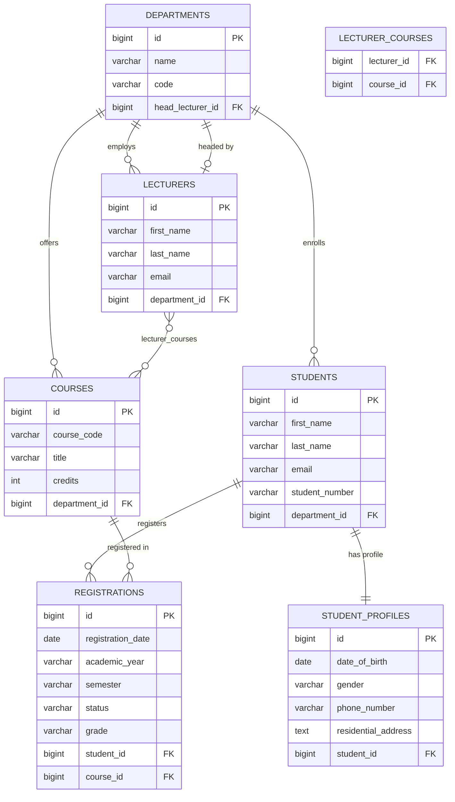

# University Course Registration & Academic Management System

Spring Boot · Spring Data JPA · Hibernate · PostgreSQL · Java 21 · Maven

---

## Problem Analysis

All universities they do need to manage their Departments, The Lecturers who belong to them, The Courses offered, The Students enrolled, and the act of a student registering for a course in a given academic year and semester. Each student also has a personal profile (date of birth, gender, contact details). The system must enforce that a student cannot register for the same course twice in the same academic year and semester.

---

## Identified Entities & Attributes

| Entity | Key Attributes |
|---|---|
| **Department** | id, name, code, headLecturer (FK) |
| **Lecturer** | id, firstName, lastName, email, department (FK) |
| **Course** | id, courseCode, title, credits, department (FK) |
| **Student** | id, firstName, lastName, email, studentNumber, department (FK) |
| **StudentProfile** | id, dateOfBirth, gender (enum), phoneNumber, residentialAddress, student (FK) |
| **Registration** | id, registrationDate, academicYear, semester, status (enum), grade, student (FK), course (FK) |

---

## Relationships & Cardinality

| Relationship | Cardinality | Mechanism |
|---|---|---|
| Department → Course | One-to-Many | Foreign key `department_id` in `courses` |
| Department → Lecturer | One-to-Many | Foreign key `department_id` in `lecturers` |
| Department → Student | One-to-Many | Foreign key `department_id` in `students` |
| Department ↔ Lecturer (head) | One-to-One | Foreign key `head_lecturer_id` in `departments` |
| Student ↔ StudentProfile | One-to-One (bidirectional) | Foreign key `student_id` in `student_profiles` (unique) |
| Lecturer ↔ Course | Many-to-Many | **Join table** `lecturer_courses` (lecturer_id, course_id) |
| Student ↔ Course | Many-to-Many via Registration | **Join entity** `registrations` with extra attributes |

---

## ERD



---

## Relational Schema

```
departments(id PK, name, code, head_lecturer_id FK→lecturers.id)

lecturers(id PK, first_name, last_name, email, department_id FK→departments.id)

courses(id PK, course_code, title, credits, department_id FK→departments.id)

students(id PK, first_name, last_name, email, student_number, department_id FK→departments.id)

student_profiles(id PK, date_of_birth, gender, phone_number, residential_address,
                 student_id FK→students.id UNIQUE)

lecturer_courses(lecturer_id FK→lecturers.id, course_id FK→courses.id,
                 PRIMARY KEY(lecturer_id, course_id))

registrations(id PK, registration_date, academic_year, semester, status, grade,
              student_id FK→students.id, course_id FK→courses.id,
              UNIQUE(student_id, course_id, academic_year, semester))
```

---

## Step-by-Step: How to Run

### Step 1 – Build & Run

```bash
# From the project root (where pom.xml lives)
cd path/to/AcademicManagementSystem

# Run the application
./mvnw spring-boot:run
```

On Windows use `mvnw.cmd` instead of `./mvnw`:
```cmd
mvnw.cmd spring-boot:run
```

You should see in the console:
```
========== SEED DATA VERIFICATION ==========
Departments  : 2
Lecturers    : 2
Courses      : 3
Students     : 2
Profiles     : 2
Registrations: 3
CS head      : Lecturer{id=1, ...}
John's regs  : 2
=============================================
```

---

### Step 2 – Run Tests

```bash
./mvnw test
```

Tests use an H2 in-memory database 

---

### Step 3 – Verify Tables in PostgreSQL

```sql
-- Connect to the database
psql -U postgres -d university_academic_db

-- List all tables
\dt

-- Check foreign keys
SELECT conname, conrelid::regclass AS table, confrelid::regclass AS references
FROM pg_constraint
WHERE contype = 'f'
ORDER BY table;

SELECT * FROM departments;
SELECT * FROM lecturers;
SELECT * FROM lecturer_courses;
SELECT * FROM registrations;
```

---

### Step 4 – Screenshots

Image 001


Image 002


Image 003


Image 004


Image 005


Image 006


---

## Key Design Decisions

- **LAZY fetching everywhere** – avoids N+1 queries and infinite recursion when entities are serialised.
- **equals/hashCode on `id` only** – safe for JPA entities; avoids issues with detached/proxied objects.
- **toString excludes collections** – prevents lazy-loading exceptions and infinite recursion.
- **Registration as a join entity** – chosen over `@ManyToMany` because it carries extra data (grade, status, dates) that a plain join table cannot hold.
- **Spring Boot 3.3.0 / Jakarta EE 10** – uses `jakarta.persistence.*` (not `javax`), compatible with Java 21.
- **H2 for tests** – `@DataJpaTest` spins up an in-memory DB so tests are fast and self-contained.
